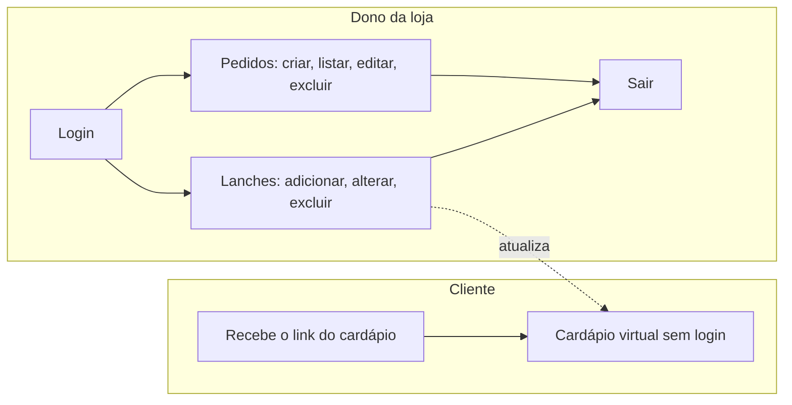
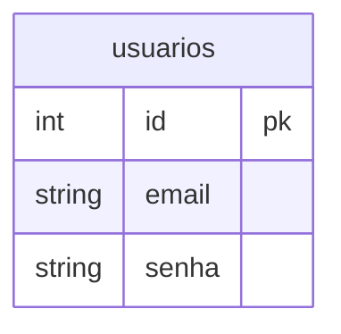
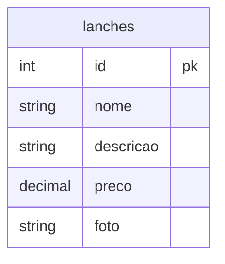
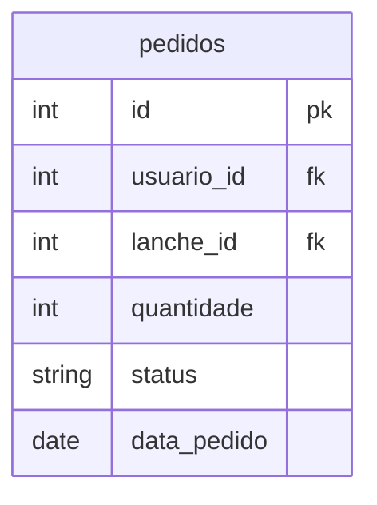
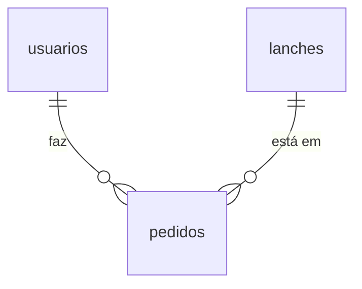

# Documentação do Sistema – Gisburguer (Hamburgueria)

Projeto integrador desenvolvido em PHP com banco de dados PostgreSQL. O sistema aplica os conceitos de PHP, banco de dados e CRUD vistos em aula e segue a estrutura do mini sistema de alunos usado como referência.

O sistema tem **duas partes**, pensadas para dois tipos de pessoa:

| Quem | O que faz no sistema | Precisa de login? |
|------|----------------------|-------------------|
| **Cliente** (visitante) | Abre o link do cardápio e vê os lanches com foto, descrição e preço | Não |
| **Dono da loja** | Monta e mantém o cardápio (adiciona, altera e remove lanches) e registra os pedidos | Sim |

A ideia principal: o dono consegue manter um **cardápio simples de entender**, sem mexer em código. Tudo o que ele altera aparece na hora para os clientes.

---

## 1. Objetivo do Sistema

O sistema permite que:

**O cliente (sem login)**
- Acesse o cardápio virtual da Gisburguer pelo link divulgado pela loja
- Veja a logo, a foto, o nome, a descrição e o preço de cada lanche

**O dono da loja (com login)**
- Crie uma conta, faça login e logout
- Cadastre, liste, edite e exclua lanches do cardápio
- Cadastre, liste, edite e exclua pedidos (e atualize o status deles)

O sistema possui **CRUDs completos** de **lanches** e **pedidos**, além do cadastro/login de usuários.

---

## 2. Requisitos Funcionais (RF)

| RF | Descrição |
|----|-----------|
| 1 | Cadastrar usuários (e-mail e senha) |
| 2 | Página de login |
| 3 | Página de logout |
| 4 | Verificar usuário logado (impedir acesso às páginas internas sem login) |
| 5 | Cadastrar um novo lanche (nome, descrição, preço, foto) |
| 6 | Listar todos os lanches cadastrados |
| 7 | Editar um lanche existente (inclusive trocar a foto) |
| 8 | Excluir um lanche |
| 9 | Cadastrar um novo pedido (cliente + lanche + quantidade + status) |
| 10 | Listar todos os pedidos cadastrados |
| 11 | Editar um pedido existente (ex.: atualizar status) |
| 12 | Excluir um pedido |
| 13 | Exibir o cardápio virtual com as fotos dos lanches, acessível a qualquer cliente **sem login** |
| 14 | Exibir a logo da Gisburguer no topo da tela de login, do cadastro e dos cardápios |

## 3. Requisitos Não Funcionais (RNF)

| RNF | Descrição |
|-----|-----------|
| 1 | Banco de dados PostgreSQL, acessado via PDO |
| 2 | Queries com *prepared statements* (`bindParam`/`bindValue`), evitando SQL Injection |
| 3 | Controle de sessão do usuário com `$_SESSION` |
| 4 | Código organizado em pastas por função, seguindo o sistema de referência visto em aula |
| 5 | Layout simples, com um CSS único compartilhado (`style/style.css`) |
| 6 | Telas simples e diretas, para que o dono da loja consiga usar sem conhecimento técnico |

> 📌 Observação: seguindo o padrão do sistema de referência, a senha é armazenada **sem criptografia** (texto puro), como simplificação para este trabalho. Em um sistema real, o ideal seria usar `password_hash()` e `password_verify()`.

---

## 4. Como Iniciar o Sistema

### 4.1 Pré-requisitos

- PHP instalado (com a extensão `pdo_pgsql` habilitada)
- PostgreSQL instalado e em execução
- Um navegador (Chrome, Firefox, Edge...)

### 4.2 Preparar o banco de dados

1. Abra o PostgreSQL (pgAdmin ou `psql`) e conecte com o usuário `hamburgueria`.
2. Crie o banco de dados do projeto.
3. Crie as tabelas `usuarios`, `lanches` e `pedidos`, com as colunas descritas na seção 6.

### 4.3 Configurar a conexão

Abra o arquivo `database/connect.php` e confira os dados de acesso ao PostgreSQL:

| Dado | Valor |
|------|-------|
| Host | `192.168.10.23` |
| Usuário | `hamburgueria` |
| Banco | `hamburgueria` |
| Senha | senha do usuário `hamburgueria` |

Se o PostgreSQL estiver na mesma máquina em que o site roda, o host também pode ser `localhost`.

### 4.4 Conferir a pasta das fotos

As fotos dos lanches ficam salvas na pasta `uploads/lanches/`. Ela precisa existir e o servidor precisa ter permissão para gravar nela. Se a pasta não existir, crie-a antes de cadastrar o primeiro lanche com foto.

### 4.5 Ligar o servidor e abrir o site

> ⚠️ **Importante:** o site usa endereços que começam na raiz (por exemplo `/style/style.css` e `/Login/login.php`). Por isso ele precisa abrir **na raiz do endereço** (`http://localhost:8000/`), e não dentro de uma subpasta (`http://localhost/Sistema-Hamburgueria/`). Em subpasta, a página aparece sem estilo e os links quebram.

**Opção A — Servidor embutido do PHP (recomendada)**
1. Abra o terminal dentro da pasta do projeto (a que contém `index.php`).
2. Execute: `php -S localhost:8000`
3. Deixe o terminal aberto (se fechar, o site sai do ar).
4. No navegador, acesse: `http://localhost:8000`

**Opção B — XAMPP/WAMP**
1. Coloque o **conteúdo** da pasta do projeto diretamente na pasta do servidor (`htdocs` no XAMPP, `www` no WAMP), sem criar subpasta, ou configure um *virtual host* apontando para a pasta do projeto.
2. Inicie o **Apache** no painel do XAMPP/WAMP.
3. No navegador, acesse: `http://localhost`

Se aparecer a tela de login da Gisburguer, o sistema está funcionando. Se aparecer erro de conexão, volte ao passo 4.3 e confira host, usuário, senha e nome do banco.

### 4.6 Problemas comuns

| Sintoma | Causa provável | Solução |
|---------|----------------|---------|
| Página sem cores, sem logo ou com links quebrados | Site aberto dentro de uma subpasta | Abrir na raiz do endereço (seção 4.5) |
| "Erro na conexão" | Dados do banco errados ou PostgreSQL desligado | Conferir `database/connect.php` e se o PostgreSQL está em execução |
| "Erro ao salvar a imagem" | Pasta `uploads/lanches/` não existe ou sem permissão de escrita | Criar a pasta e liberar a gravação (seção 4.4) |
| Foto aparece como "Sem foto" no cardápio | Lanche cadastrado sem foto | Editar o lanche e enviar uma foto |
| Links de login/logout dão "não encontrado" em servidor Linux | O código chama a pasta de `Login/`, e o Linux diferencia maiúsculas de minúsculas | Garantir que o nome da pasta seja igual ao usado no código (`Login`) |

---

## 5. Como Usar o Sistema (Passo a Passo)

### 5.1 Como o cliente acessa o site

O cliente **não precisa criar conta nem fazer login** para ver o cardápio.

1. A loja divulga o **link do cardápio** para os clientes (por WhatsApp, Instagram, QR Code impresso na mesa ou no balcão etc.). O link é o endereço do site seguido de `/cardapio-publico.php`:

   | Onde o site está | Link do cardápio |
   |------------------|------------------|
   | No computador da loja (teste) | `http://localhost:8000/cardapio-publico.php` |
   | Na rede da loja (Wi-Fi) | `http://ENDEREÇO-IP-DO-COMPUTADOR:8000/cardapio-publico.php` |
   | Em um servidor/hospedagem | `http://ENDEREÇO-DO-SITE/cardapio-publico.php` |

   > Para outros aparelhos (como o celular do cliente) conseguirem abrir o link, eles precisam alcançar o computador onde o site está rodando (por exemplo, estar no mesmo Wi-Fi) ou o site precisa estar em uma hospedagem na internet. Na rede da loja, inicie o servidor com `php -S 0.0.0.0:8000` para que outros aparelhos consigam acessar.

2. Ao abrir o link, o cliente vê:
   - a **logo da Gisburguer** no topo;
   - os lanches em cartões, cada um com **foto, nome, descrição e preço** (lanches sem foto aparecem com o aviso "Sem foto");
   - o link **"Já sou cliente / Fazer pedido"**, que leva à tela de login.

3. O cardápio é atualizado automaticamente: quando o dono adiciona, altera ou remove um lanche, o cliente já vê a mudança ao recarregar a página.

> Abrir apenas o endereço do site (`http://localhost:8000`) **não** mostra o cardápio ao cliente: esse endereço leva para a tela de login (ou para a área do dono, se já houver login). Por isso, o link a divulgar é sempre o do cardápio (`/cardapio-publico.php`).

### 5.2 Criar uma conta (primeiro acesso do dono)
1. Na tela de login, clique em **Cadastre-se** (`login/cadastrar.php`).
2. Digite o **e-mail** e uma **senha**.
3. Clique em **Cadastrar**. A conta é criada e você volta para o login.

### 5.3 Fazer login
1. Acesse a tela de login (`login/login.php`), que mostra a logo da Gisburguer.
2. Digite o e-mail e a senha cadastrados e clique em **Entrar**.
3. Se os dados estiverem corretos, você entra na área do cardápio (a lista de lanches). Se não baterem com nenhum cadastro, aparece o aviso de **usuário inexistente**.

> Páginas internas (lanches e pedidos) só abrem para quem está logado. Quem tentar acessar sem login é enviado para a tela de login por `verifica-login.php`.

### 5.4 Como o dono monta e altera o cardápio

Depois do login, a tela **Cardápio de Lanches** (`app/lanches/select.php`) mostra uma tabela com todos os lanches (nome, descrição, preço) e as ações de cada um. É aqui que o dono faz tudo:

**Adicionar um item novo**
1. Clique em **+ Novo lanche** (`app/lanches/create.php`).
2. Preencha o **nome** (ex.: X-Gis), a **descrição** (ex.: pão, burger, queijo e salada) e o **preço** em reais (ex.: 29,90).
3. Escolha uma **foto** do lanche (opcional, mas recomendada: sem foto o cardápio mostra "Sem foto").
4. Clique em **Salvar**. O lanche já aparece na lista e no cardápio dos clientes.

**Alterar um item (nome, descrição, preço ou foto)**
1. Na lista, clique em **Editar** no lanche desejado (`app/lanches/update.php`).
2. Altere o que precisar. Para trocar a foto, escolha uma nova; se não escolher nenhuma, a foto atual é mantida.
3. Clique em **Salvar**.

**Remover um item**
1. Na lista, clique em **Excluir** no lanche desejado (`app/lanches/delete.php`).
2. Confirme na pergunta "Excluir este lanche?". O lanche é removido do banco e some do cardápio.

> 💡 Dica: para conferir como o cliente está vendo o cardápio, abra `/cardapio-publico.php` em outra aba.

### 5.5 Gerenciar pedidos
Os pedidos ficam em `app/pedidos/select.php` (endereço: `http://ENDEREÇO-DO-SITE/app/pedidos/select.php`). Nessa tela é possível:
- **Listar:** ver todos os pedidos, com cliente, lanche, quantidade, status e data.
- **Cadastrar:** clique em **+ Novo pedido** (`app/pedidos/create.php`), escolha o **cliente** (uma conta cadastrada), o **lanche**, a **quantidade** e o **status** (pendente, em preparo, pronto ou entregue), e salve.
- **Editar:** clique em **Editar** (`app/pedidos/update.php`). É aqui que se atualiza o **status** do pedido.
- **Excluir:** clique em **Excluir** (`app/pedidos/delete.php`) e confirme. O pedido é removido do banco.

### 5.6 Sair do sistema
Clique em **Sair** (`login/logout.php`). A sessão é encerrada e, para voltar às páginas internas, será preciso fazer login de novo. O cardápio dos clientes continua funcionando normalmente.

### 5.7 Resumo do fluxo



---

## 6. Estrutura do Banco de Dados

### Tabela `usuarios`


### Tabela `lanches`


### Tabela `pedidos`


### Relacionamentos


- Um usuário pode ter vários pedidos.
- Um lanche pode aparecer em vários pedidos.
- Na tabela `lanches`, a coluna `foto` guarda apenas o **nome do arquivo**; a imagem em si fica na pasta `uploads/lanches/`.

---

## 7. Estrutura de Pastas

```
Sistema-Hamburgueria/
├── app/
│   ├── lanches/
│   │   ├── create.php
│   │   ├── select.php
│   │   ├── update.php
│   │   └── delete.php
│   └── pedidos/
│       ├── create.php
│       ├── select.php
│       ├── update.php
│       └── delete.php
├── database/
│   └── connect.php
├── documentacoes/
│   └── documentacao.md
├── img/
│   ├── logo-gisburguer.svg
│   └── logo-gisburguer-claro.svg
├── includes/
│   ├── header.php
│   ├── footer.php
│   └── functions.php
├── login/
│   ├── cadastrar.php
│   ├── login.php
│   ├── logout.php
│   └── verifica-login.php
├── style/
│   └── style.css
├── uploads/
│   └── lanches/            (fotos dos lanches enviadas pelo dono)
├── cardapio-publico.php
└── index.php
```

| Arquivo | Função |
|---------|--------|
| `database/connect.php` | Conexão com o PostgreSQL via PDO |
| `login/cadastrar.php` | Formulário de cadastro de usuário |
| `login/login.php` | Formulário e validação de login |
| `login/logout.php` | Encerra a sessão |
| `login/verifica-login.php` | Bloqueia páginas para quem não está logado |
| `app/lanches/create.php` | Cadastro de lanche (com foto) |
| `app/lanches/select.php` | Lista os lanches (cardápio do dono) |
| `app/lanches/update.php` | Edita um lanche |
| `app/lanches/delete.php` | Exclui um lanche |
| `app/pedidos/create.php` | Cadastro de pedido |
| `app/pedidos/select.php` | Lista os pedidos |
| `app/pedidos/update.php` | Edita um pedido |
| `app/pedidos/delete.php` | Exclui um pedido |
| `cardapio-publico.php` | **Cardápio virtual para o cliente**, sem login |
| `index.php` | Página inicial: envia para o login (ou para a lista de lanches, se já houver login) |
| `includes/functions.php` | Funções PHP com as queries (cadastrar, consultar, listar, atualizar, excluir) |
| `includes/header.php` / `footer.php` | Cabeçalho e rodapé compartilhados |
| `style/style.css` | Estilo único das páginas (inclui o visual do login e da logo) |
| `img/` | Logo da Gisburguer (versão normal e versão clara para fundo laranja) |
| `uploads/lanches/` | Fotos dos lanches |

---

## 8. Tecnologias

- **Back-end:** PHP
- **Banco de dados:** PostgreSQL (via PDO)
- **Front-end:** HTML + CSS
- **Logo:** SVG (imagem vetorial, não perde qualidade em nenhum tamanho)
- **Sessão:** `$_SESSION` do PHP para login/logout

---

## 9. Etapas Realizadas

1. Criação do banco de dados e das tabelas
2. Adaptação de `database/connect.php` para o novo banco
3. Adaptação de `includes/functions.php` com as funções necessárias
4. Implementação de cadastro e login
5. Implementação do CRUD de lanches
6. Implementação do CRUD de pedidos
7. Criação do cardápio virtual com fotos (`cardapio-publico.php`)
8. Ajustes de `index.php` e do layout (`style.css`)
9. Criação da logo da Gisburguer e centralização da tela de login
10. Teste do fluxo completo: cadastro → login → lanches → pedidos → logout, e abertura do cardápio sem login

## 10. Considerações Finais

O sistema atende ao proposto: um cardápio virtual para os clientes e uma área para o dono da loja manter o cardápio e os pedidos, com uso de PDO e prepared statements, controle de sessão e organização em pastas.

**Pontos de atenção**
- **Todas as contas têm o mesmo acesso.** Como o cadastro é aberto, qualquer pessoa que criar uma conta consegue entrar na área do dono e alterar o cardápio. Por isso, o link divulgado aos clientes deve ser o do cardápio (`/cardapio-publico.php`) e, enquanto não houver níveis de acesso, a tela de cadastro deve ficar restrita ao dono.
- **Senhas em texto puro**, como no sistema de referência.

**Melhorias futuras**
- Níveis de acesso (administrador/dono e cliente), para que só o dono edite o cardápio
- Hash de senha (`password_hash()`)
- Validação mais completa de formulários (por exemplo, tipo e tamanho das fotos enviadas)
- Link para os pedidos dentro da tela de lanches e link para o cardápio público na tela de login